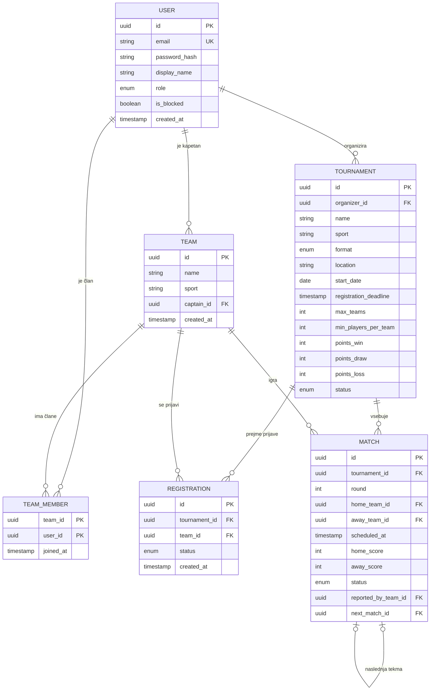

# 03 – Podatkovni model

Rešitev uporablja relacijsko bazo **PostgreSQL**. Podatki so močno povezani (uporabniki ↔ ekipe ↔ turnirji ↔ tekme), zato so tuji ključi, enolične omejitve in transakcije zelo primerni.

## Entitete

Model vsebuje šest entitet. Jedro so povezane entitete **User**, **Team**, **Tournament** in **Match**, **TeamMember** in **Registration** pa sta vezni entiteti za razmerji M:N.

### User (uporabnik)

| Polje | Tip | Opis |
|---|---|---|
| id | UUID, PK | Enolični identifikator |
| email | varchar, UNIQUE | E-pošta (prijavno ime) |
| password_hash | varchar | Zgoščeno geslo (bcrypt) |
| display_name | varchar | Prikazno ime |
| role | enum | PLAYER, ORGANIZER, ADMIN |
| is_blocked | boolean | Blokiran račun |
| created_at | timestamp | Čas registracije |

### Team (ekipa)

| Polje | Tip | Opis |
|---|---|---|
| id | UUID, PK | |
| name | varchar | Ime ekipe |
| sport | varchar | Šport ekipe |
| captain_id | UUID, FK → User | Kapetan ekipe |
| created_at | timestamp | |

### TeamMember (član ekipe)

| Polje | Tip | Opis |
|---|---|---|
| team_id | UUID, FK → Team | |
| user_id | UUID, FK → User | |
| joined_at | timestamp | |

Primarni ključ: (team_id, user_id).

### Tournament (turnir)

| Polje | Tip | Opis |
|---|---|---|
| id | UUID, PK | |
| organizer_id | UUID, FK → User | Organizator |
| name | varchar | Ime turnirja |
| sport | varchar | Šport |
| format | enum | ROUND_ROBIN, SINGLE_ELIMINATION |
| location | varchar | Lokacija |
| start_date | date | Začetek |
| registration_deadline | timestamp | Rok prijav |
| max_teams | int | Največ ekip |
| min_players_per_team | int | Najmanj igralcev v ekipi |
| points_win / points_draw / points_loss | int | Pravila točkovanja |
| status | enum | DRAFT, REGISTRATION_OPEN, REGISTRATION_CLOSED, IN_PROGRESS, FINISHED, CANCELLED |

### Registration (prijava ekipe na turnir)

| Polje | Tip | Opis |
|---|---|---|
| id | UUID, PK | |
| tournament_id | UUID, FK → Tournament | |
| team_id | UUID, FK → Team | |
| status | enum | PENDING, APPROVED, REJECTED, WAITLISTED |
| created_at | timestamp | |

Omejitev: UNIQUE (tournament_id, team_id).

### Match (tekma)

| Polje | Tip | Opis |
|---|---|---|
| id | UUID, PK | |
| tournament_id | UUID, FK → Tournament | |
| round | int | Krog / kolo |
| home_team_id | UUID, FK → Team | Domača ekipa |
| away_team_id | UUID, FK → Team, nullable | Gostujoča ekipa (null = prosti prehod) |
| scheduled_at | timestamp | Predviden čas |
| home_score / away_score | int, nullable | Rezultat |
| status | enum | SCHEDULED, AWAITING_CONFIRMATION, CONFIRMED, DISPUTED, CANCELLED |
| reported_by_team_id | UUID, FK → Team, nullable | Ekipa, ki je vnesla rezultat |
| next_match_id | UUID, FK → Match, nullable | Naslednja tekma (izločanje) |

## Povezave med entitetami

- **User 1 : N Team** – uporabnik je kapetan več ekip (Team.captain_id).
- **User M : N Team** prek **TeamMember** – uporabnik je član več ekip, ekipa ima več članov.
- **User 1 : N Tournament** – organizator ima več turnirjev (Tournament.organizer_id).
- **Tournament M : N Team** prek **Registration** – ekipa se prijavi na več turnirjev, turnir ima več ekip.
- **Tournament 1 : N Match** – turnir vsebuje več tekem.
- **Team 1 : N Match** – ekipa nastopa v več tekmah (kot domača ali gostujoča).
- **Match 1 : 0..1 Match** – tekma v izločilnem drevesu kaže na naslednjo tekmo.

## Osnutek podatkovnega modela (ER diagram)

<!-- ## Opomba o lestvici

Lestvica **ni** shranjena kot posebna entiteta. Izračuna se sproti iz potrjenih tekem (status CONFIRMED) in pravil točkovanja turnirja. S tem se izognemo podvojenim podatkom in neskladjem med rezultati in lestvico. -->
