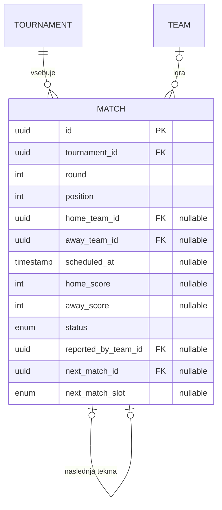

# 03.1 – Podatkovni model: popravki po implementaciji

Ta dokument dopolnjuje [03 – Podatkovni model](03-podatkovni-model.md). Izvirni dokument ostaja nespremenjen kot zasnova pred implementacijo. Tukaj so zapisane razlike, ki so se pokazale pri implementaciji MVP (US-01 do US-07), z razlogi zanje. Veljaven model je v datoteki `backend/prisma/schema.prisma`.

## Povzetek sprememb

Vse spremembe so pri entiteti **Match**. Entitete User, Team, TeamMember, Tournament in Registration se ujemajo z izvirnim dokumentom.

| # | Sprememba | Polje | Razlog | Zgodba |
|---|---|---|---|---|
| 1 | Novo polje | `position` (int) | Vrstni red tekme znotraj kola; v izločilnem drevesu določa, kateri tekmi sta združeni v naslednjo tekmo. | US-05 |
| 2 | Novo polje | `next_match_slot` (enum HOME, AWAY, nullable) | Pove, v katero mesto naslednje tekme (domača ali gostujoča ekipa) se vpiše zmagovalec. Samo `next_match_id` tega ne pove. | US-05, US-07 |
| 3 | Spremenjeno | `home_team_id` je nullable | V poznejših krogih izločanja zmagovalca prejšnje tekme še ni, zato domača ekipa ni znana. | US-05 |
| 4 | Spremenjeno | `scheduled_at` je nullable | Generiranje razporeda ne določa ur tekem; čas se lahko doda pozneje. | US-05 |
| 5 | Pojasnilo | pomen `away_team_id = null` | Glej razdelek o praznih mestih spodaj. | US-05 |
| 6 | Nov indeks | (`tournament_id`, `round`) | Hitro nalaganje razporeda po kolih. | US-05 |

## Match (tekma) – popravljena različica

| Polje | Tip | Opis |
|---|---|---|
| id | UUID, PK | |
| tournament_id | UUID, FK → Tournament | Pri brisanju turnirja se tekme izbrišejo (CASCADE). |
| round | int | Krog / kolo (od 1 naprej) |
| **position** | int | **Novo.** Zaporedna številka tekme v kolu (od 0 naprej). |
| home_team_id | UUID, FK → Team, **nullable** | Domača ekipa; null, dokler ni znana (izločanje). |
| away_team_id | UUID, FK → Team, nullable | Gostujoča ekipa; null pomeni prosti prehod ali čakanje na zmagovalca. |
| scheduled_at | timestamp, **nullable** | Predviden čas; trenutno ga razpored ne nastavi. |
| home_score / away_score | int, nullable | Rezultat; nenegativno celo število. |
| status | enum | SCHEDULED, AWAITING_CONFIRMATION, CONFIRMED, DISPUTED, CANCELLED |
| reported_by_team_id | UUID, FK → Team, nullable | Ekipa, ki je vnesla rezultat. |
| next_match_id | UUID, FK → Match, nullable | Naslednja tekma (izločanje); pri finalu in v ligi null. |
| **next_match_slot** | enum HOME / AWAY, nullable | **Novo.** Mesto v naslednji tekmi, kamor napreduje zmagovalec. |

Tuji ključi na ekipe (`home_team_id`, `away_team_id`, `reported_by_team_id`) in `next_match_id` imajo pri brisanju vrednost SET NULL.

### Prazna mesta v tekmi

Pri izločanju sta lahko ekipi v tekmi prazni iz dveh različnih razlogov:

| Stanje | Kje | Pomen | Status tekme |
|---|---|---|---|
| `home_team_id` ≠ null, `away_team_id` = null | 1. krog | **Prosti prehod**: domača ekipa napreduje brez igranja. Zmagovalec je ob generiranju že vpisan v naslednjo tekmo. | CONFIRMED |
| `home_team_id` = null ali `away_team_id` = null | 2. krog in naprej | **Čakanje na zmagovalca** prejšnje tekme. Tekme ni mogoče igrati, dokler nista znani obe ekipi. | SCHEDULED |

V ligi (ROUND_ROBIN) sta vedno znani obe ekipi; pri lihem številu ekip ena ekipa v kolu počiva, tekma zanjo pa se ne ustvari.

### Napredovanje zmagovalca

Ko tekma v izločilnem drevesu preide v CONFIRMED, se zmagovalec v isti transakciji vpiše v naslednjo tekmo na mesto, ki ga določa `next_match_slot`. Če so po tem vse tekme turnirja potrjene (ali preklicane), turnir preide v FINISHED.

Primer za 5 ekip (velikost drevesa 8, trije prosti prehodi):

```
1. krog (position)       2. krog (position)                 Finale
0: E1 : prosto      ─┐
                     ├─ 0: E1 : zmagovalec tekme 1-1 ─┐
1: E4 : E5          ─┘                                │
                                                      ├─ Finale
2: E2 : prosto      ─┐                                │
                     ├─ 1: E2 : E3 ───────────────────┘
3: E3 : prosto      ─┘
```

Ekipe so uvrščene po vrstnem redu prijave (prej prijavljena ekipa je višje postavljena); najvišje postavljene ekipe dobijo proste prehode, nosilca 1 in 2 pa se lahko srečata šele v finalu.

## Dopolnitev ER diagrama

V diagramu iz dokumenta 03 se entiteta MATCH spremeni takole:



## Popravek povezav

Povezava **Team 1 : N Match** iz dokumenta 03 velja z dopolnilom: ekipa nastopa kot domača ali gostujoča, v izločilnem drevesu pa je lahko mesto v tekmi tudi prazno (null), dokler ni znan zmagovalec prejšnje tekme.

## Opombe k nespremenjenim entitetam

Ti vidiki iz implementacije ne spreminjajo tabel, vendar je koristno, da so zapisani:

- **Registration:** vrednost WAITLISTED je v modelu, vendar jo MVP ne uporablja. Če je turnir poln, se prijava zavrne. Zavrnjena prijava (REJECTED) ne zaseda igralcev, ista ekipa pa se na isti turnir zaradi omejitve UNIQUE (`tournament_id`, `team_id`) ne more prijaviti znova.
- **TeamMember in Registration:** pri brisanju ekipe se vrstice izbrišejo (CASCADE).
- **User.display_name:** ni enolično. Pri dodajanju člana po imenu aplikacija sprejme samo ime, ki ustreza natanko enemu uporabniku (brez razlikovanja velikih in malih črk); sicer zahteva e-pošto.
- **Lestvica:** v podatkovnem modelu ni shranjena. Izračuna se sproti iz tekem v stanju CONFIRMED (odločitev ADR 0004).
