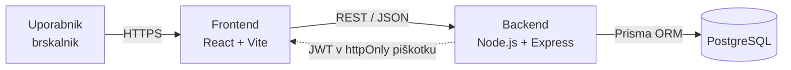

# 04 – Arhitektura in tehnološki sklad

## Arhitektura

### Glavni deli sistema

1. **Frontend** – React aplikacija, ki prikazuje turnirje, ekipe, razporede in lestvice ter pošilja uporabnikova dejanja.
2. **Backend(REST API)** – Node.js strežnik z Express, ki vsebuje poslovno logiko (validacija prijav, generiranje razporeda, potrjevanje rezultatov, izračun lestvice) in preverja pravice po vlogah.
3. **Podatkovna baza** – PostgreSQL, v kateri so shranjeni vsi trajni podatki.

### Komunikacija med deli

- Frontend komunicira z backendom prek **REST API (JSON prek HTTPS)**.
- Backend do baze dostopa prek ORM orodja **Prisma**.
- Primeri končnih točk: `POST /api/auth/login`, `GET /api/tournaments`, `POST /api/tournaments/:id/registrations`, `POST /api/tournaments/:id/schedule`, `POST /api/matches/:id/result`, `POST /api/matches/:id/confirm`, `GET /api/tournaments/:id/standings`.

### Podatkovna baza

PostgreSQL z relacijskim modelom (glej `03-podatkovni-model.md`). Spremembe sheme se upravljajo z Prisma migracijami. Kritične operacije (generiranje razporeda, potrditev rezultata in napredovanje v izločilnem drevesu) tečejo znotraj **transakcij**.

### Avtentikacija in upravljanje uporabnikov

- Registracija z e-pošto in geslom; geslo se shrani zgoščeno z **bcrypt**.
- Ob prijavi backend izda **JWT**.
- Middleware preveri veljavnost žetona in **vlogo** (PLAYER / ORGANIZER / ADMIN) za zaščitene poti.
- Dodatno se preverja lastništvo (npr. samo organizator turnirja lahko potrjuje prijave na svoj turnir, samo kapetan lahko prijavi ekipo).

### Način lokalnega zagona

Projekt se zažene z **Docker Compose** (storitve: `db`, `api`, `web`):

```bash
git clone <repozitorij>
cd turnirhub
cp .env.example .env
docker compose up --build
```

- Frontend: http://localhost:5173
- Backend API: http://localhost:3000
- PostgreSQL: localhost:5432


### Diagram arhitekture



## Tehnološki sklad

| Področje | Tehnologija / orodje |
|---|---|
| Frontend | React, Vite, Tailwind CSS |
| Backend | Node.js, Express |
| Podatkovna baza | PostgreSQL, Prisma ORM |
| Avtentikacija | JWT (jsonwebtoken), bcrypt|
| Lokalni razvoj | Docker Compose |

## Arhitekturne odločitve

1. **PostgreSQL namesto MongoDB.** Podatki so izrazito relacijski.
2. **React in ločen API.** Jasna ločitev odgovornosti: frontend skrbi za prikaz, backend za pravila in varnost. Omogoča tudi kasnejši razvoj mobilne aplikacije z istim API-jem.
3. **Prisma ORM.** Tipsko varen dostop do baze, vgrajene migracije in manj ponavljajoče kode kot pri ročnem SQL-u. 
4. **Lestvica se izračuna sproti, ne shranjuje.** Preprečuje podvojene podatke in neskladja; pri obsegu amaterskih turnirjev je zmogljivost več kot dovolj.
5. **Docker Compose za lokalni zagon.** En ukaz zažene celotno okolje.
6. **