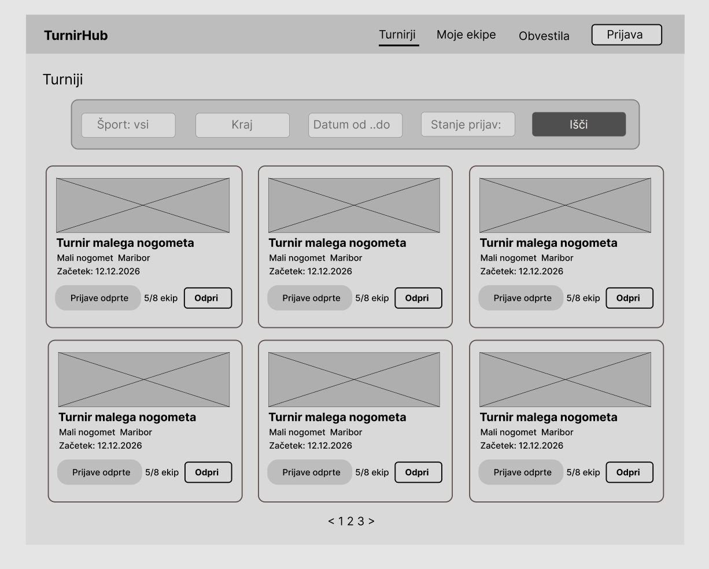
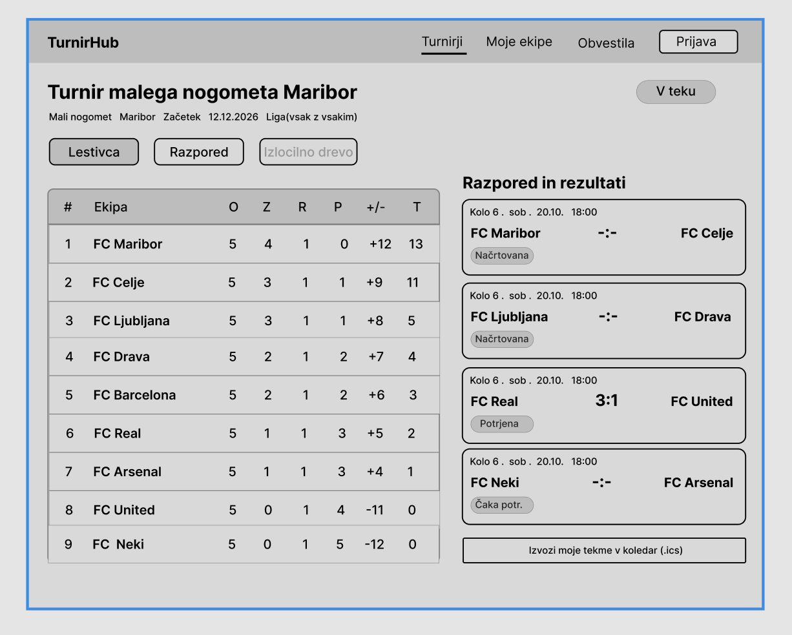
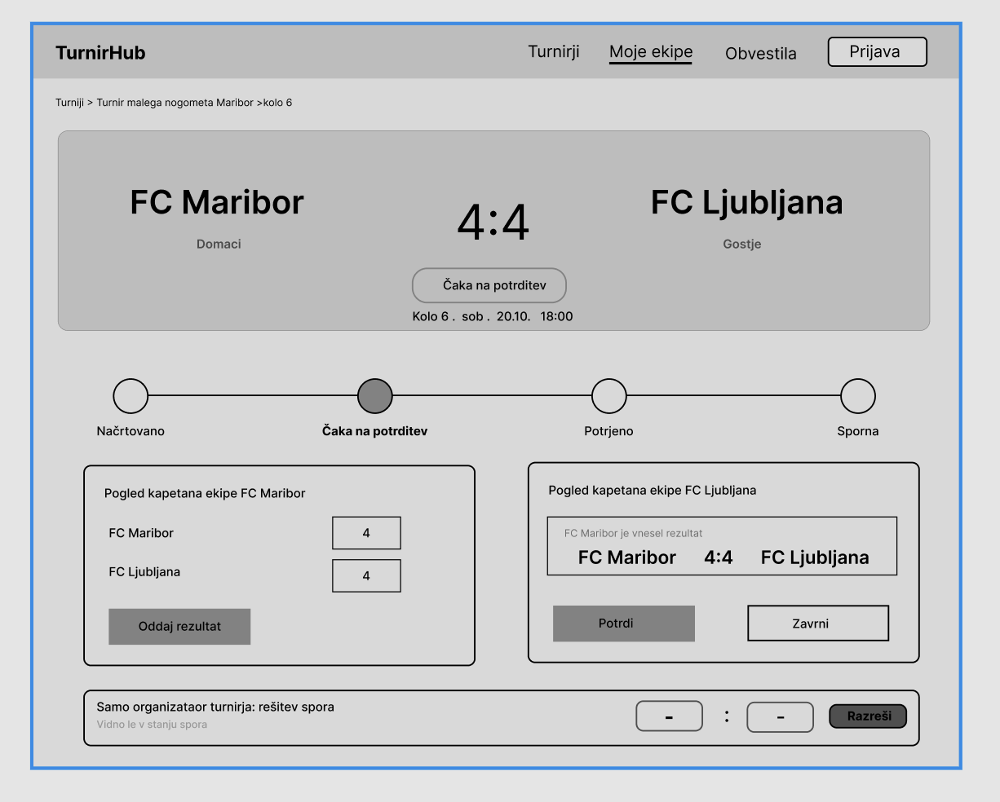

# 05 – Wireframes

## 1. Seznam turnirjev

**Kaj prikazuje:** Glavni pregled objavljenih turnirjev. Na vrhu je navigacija (Turnirji, Moje ekipe, Obvestila, Prijava), pod njo vrstica s filtri po športu, kraju, datumu in stanju prijav ter gumb „Išči“. Rezultati so prikazani kot kartice z imenom turnirja, športom, krajem, datumom začetka, značko stanja prijav (npr. „Prijave odprte“, „Čakalna lista“) in številom prijavljenih ekip.

---

## 2. Javna stran turnirja

**Kaj prikazuje:** Stran posameznega turnirja, dostopna tudi brez prijave. Na vrhu so ime, osnovni podatki in stanje turnirja. Zavihki omogočajo preklop med lestvico, razporedom in izločilnim drevesom (aktivno samo pri formatu izločanja). Na levi je lestvica (mesto, ekipa, odigrane tekme, zmage, remiji, porazi, razlika v zadetkih, točke), ki se izračuna samodejno iz potrjenih rezultatov. Na desni je razpored s kolom, časom, ekipama, rezultatom in stanjem tekme. Prijavljen igralec ima na voljo še gumb za izvoz svojih tekem v koledar (.ics).

---

## 3. Vnos in potrditev rezultata tekme

**Kaj prikazuje:** Stran posamezne tekme z ekipama, trenutnim rezultatom, časom, lokacijo in časovnico stanj (načrtovana, čaka na potrditev, potrjena, sporna). Spodaj sta prikazana dva pogleda istega zaslona glede na vlogo uporabnika: kapetan, ki rezultat vnaša, izpolni polji za zadetke in klikne „Oddaj rezultat“; kapetan nasprotne ekipe vidi vneseni rezultat in ga potrdi ali zavrne. Na dnu je območje, ki je vidno samo organizatorju turnirja in samo pri sporni tekmi, kjer lahko določi končni rezultat.

